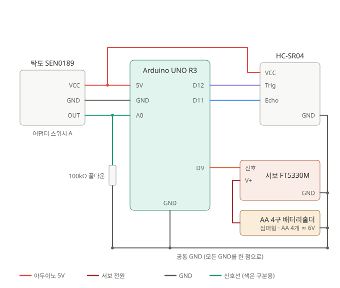
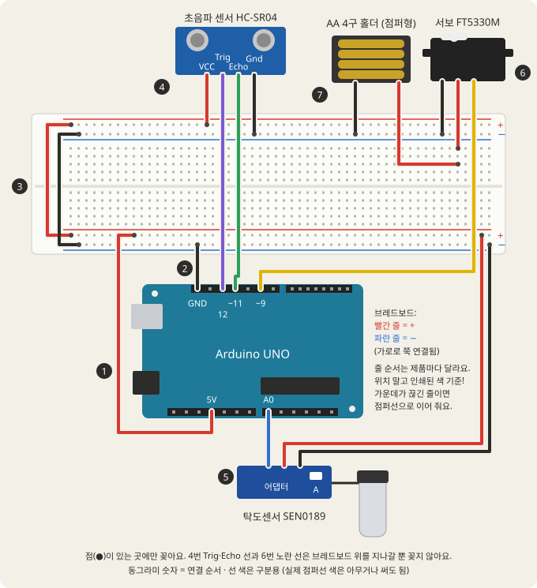

# 차단판 자동 제어 – Arduino 코드

초기우수 선택 처리 빗물받이(1조)의 **측정챔버 → 2중 타공 차단판** 제어 코드입니다.
탁도를 재서 탁하면 판을 열어 하부 필터로 보내고(처리), 맑으면 닫아 두어 측면 월류로 빠지게 합니다(우회).

- 코드: [`RAIN/RAIN.ino`](RAIN/RAIN.ino)
- 상태: UNO 실제 보드에서 업로드·동작 확인 (플래시 47%, RAM 31%). 탁도·서보는 실물 시험, 수위센서는 챔버 설치 전.
- 현재 버전은 **가지고 있는 부품으로 동작을 구현·확인하기 위한 벤치 시험용**입니다.
  수위센서(HC-SR04) 설치 방법과 물방울 대책은 [추가 검토 필요 A](#추가-검토-필요) 참고.

---

## 1. 부품과 연결

| 부품 | 핀 | 메모 |
|---|---|---|
| 탁도센서 DFRobot SEN0189 | A0 | 어댑터 스위치 **A(아날로그)**. A0–GND 사이 100 kΩ 풀다운 권장 |
| 초음파 HC-SR04 | Trig D12, Echo D11 | 5 V. 챔버 안에 설치하므로 물방울 덮개 필요 |
| 서보 FT5330M | 신호 D9 | 선 3가닥: 노랑 = 신호, 빨강 = +, 검정 = − |
| 서보 전원: AA 4구 배터리홀더 점퍼타입 (BPH-AA-018) | – | AA 4개 직렬 ≈ 6V. 끝이 점퍼 핀이라 브레드보드에 바로 꽂음. 스위치 없음 |

부저·LED·해제 버튼은 사용하지 않습니다. 상태는 시리얼 로그나 제어판으로 확인합니다. 경보 기능은 없습니다.

### 배선도



### 브레드보드 조립 순서 (실물 그림)



그림의 동그라미 숫자 순서대로 꽂으면 됩니다. 핀 이름은 **부품에 인쇄된 글자 그대로** 적었습니다.

> 브레드보드 읽는 법
> - 위·아래 가장자리의 **빨간 줄(+) / 파란 줄(−)** 은 가로로 길게 전부 연결되어 있습니다.
> - 가운데 구멍들은 **세로 5칸**이 한 묶음으로 연결되어 있고, 가운데 홈을 넘어가면 끊깁니다.

| 순서 | 어디에서 | 어디로 |
|---|---|---|
| 1 | 아두이노 아래쪽 줄 **5V** | 브레드보드 **아래** 빨간 줄(+) |
| 2 | 아두이노 위쪽 줄 **GND** (13번 바로 옆) | 브레드보드 **아래** 파란 줄(−) |
| 3 | 브레드보드 위 빨간 줄 | 아래 빨간 줄 (위·아래 + 이어주기) |
| 3 | 브레드보드 위 파란 줄 | 아래 파란 줄 (위·아래 − 이어주기) |
| 4 | 초음파 보드 **VCC** (5V) | 브레드보드 **위** 빨간 줄(+) |
| 4 | 초음파 보드 **GND** | 브레드보드 **위** 파란 줄(−) |
| 4 | 초음파 보드 **Trig** | 아두이노 **12** |
| 4 | 초음파 보드 **Echo** | 아두이노 **~11** |
| 5 | 탁도 어댑터 스위치 | **A** 쪽으로 밀기 (D 아님) |
| 5 | 탁도 케이블 **빨간 선** | 브레드보드 **아래** 빨간 줄(+) |
| 5 | 탁도 케이블 **검은 선** | 브레드보드 **아래** 파란 줄(−) |
| 5 | 탁도 케이블 **파란 선** (신호) | 아두이노 **A0** |
| 6 | 서보 **노란 선** (신호) | 아두이노 **~9** |
| 6 | 서보 **검은 선** (−) | 브레드보드 **위** 파란 줄(−) |
| 6 | 서보 **빨간 선** | 브레드보드 가운데 **아무 데도 안 쓰는 세로줄** |
| 7 | 배터리홀더 **빨간 핀(+)** | 서보 빨간 선과 **같은 세로줄** |
| 7 | 배터리홀더 **검은 핀(−)** | 브레드보드 **위** 파란 줄(−) |

주의할 점
- **배터리홀더 빨간 핀(+)은 절대 브레드보드 빨간 줄(+)에 꽂지 않습니다.** 빨간 줄은 아두이노 5V 전용입니다. 섞이면 아두이노나 USB 포트가 상할 수 있습니다.
- 반대로 **검은 선(−)은 전부 파란 줄에 모입니다.** 이렇게 GND를 하나로 묶어야 서보가 아두이노 신호를 알아듣습니다.
- 초음파 보드(HC-SR04)는 아래쪽에 **수(male) 핀 4개**가 있고, 핀 옆에 `VCC`, `Trig`, `Echo`, `Gnd`가 인쇄되어 있습니다. 책상 시험 때는 브레드보드에 바로 꽂아도 되고, 챔버에 달 때는 **암-수 점퍼선**(한쪽 구멍, 한쪽 핀)으로 구멍 쪽을 센서 핀에 끼워 길게 뺍니다.
- 탁도 케이블 색이 다르면 어댑터 기판에 인쇄된 글자를 보세요. `+`(또는 VCC) = 빨간 줄, `−`(또는 GND) = 파란 줄, `A`(또는 OUT, 신호) = A0입니다.
- 100 kΩ 풀다운 저항은 이 쉬운 그림에서는 뺐습니다(없어도 동작함). 달 때는 A0에 꽂힌 줄과 파란 줄(−) 사이에 저항을 하나 꽂으면 됩니다.
- 아두이노 USB는 **모든 선을 다 꽂은 뒤 마지막에** 연결합니다.

### 전원·배선 원칙
- **서보는 Arduino 5 V 핀에서 전원을 받지 않는다.** 35 kg급 서보는 판을 밀 때 수 A까지 흘러 Arduino가 리셋됩니다. AA 4구 배터리홀더(약 6V)로 따로 공급합니다.
- 새 알카라인 AA 4개는 약 6.4V까지 나옵니다. FT5330M 허용 전압 상한을 확인하고, 6V가 상한이면 충전식(니켈수소) AA를 씁니다.
- 배터리홀더에 스위치가 없으므로, 안 쓸 때는 빨간 핀을 뽑거나 건전지를 빼 둡니다.
- 서보 전원 GND와 Arduino GND는 **한 점에서 공통 연결**합니다. 안 하면 신호가 안 먹습니다.
- 탁도 아날로그선은 서보 전원선과 떨어뜨립니다. 모터 잡음이 ADC에 섞입니다.
- A0 풀다운 저항: 탁도센서 선이 빠지면 A0가 떠서 아무 값이나 읽힙니다. 풀다운이 있으면 0으로 읽혀 **탁도 지수 100% → 처리 쪽**으로 갑니다. 고장이 나도 오염수를 우회시키지 않는 쪽으로 기울게 하는 장치입니다.

---

## 2. 전체 흐름

```
  FILL ──(수위 ≥40mm 1초)──▶ MEASURE ──(3초 안정화 후 판단)──┬──▶ TREAT (판 열림)
   ▲                          │                             └──▶ BYPASS (판 닫힘)
   │◀───────(수위 <20mm)──────┴── TREAT / BYPASS 에서도 동일 ──┘
   │◀───────(수위값 1초 없음)── 어느 상태든 판 닫고 대기, 값이 돌아오면 이어서 판단
                                        TREAT ◀──▶ BYPASS (탁도 히스테리시스)
```

판이 열리는 것은 **TREAT 상태뿐**입니다. 나머지 상태는 모두 닫힘입니다.

0.1초마다 아래 순서로 판단합니다. 위 단계에서 걸리면 아래는 보지 않습니다.

1. 센서 읽기 (수위, 탁도)
2. 수위값 확인 (없으면 판 닫고 채움에서 대기)
3. 수위 판정 (20 mm / 40 mm)
4. 수질 판정 (15% / 25%)
5. 서보 출력

1초마다 시리얼로 CSV 한 줄을 출력합니다.

---

## 3. 상태별 동작

| 상태 | 판 | 하는 일 | 다음 상태 |
|---|---|---|---|
| FILL | 닫힘 | 챔버에 물이 차기를 기다림 | 수위 ≥ 40 mm가 **1초** 유지 → MEASURE |
| MEASURE | 닫힘 | 탁도 표본을 새로 모으고 **3초 안정화** 후 판단 | 아래 표 |
| TREAT | **열림** | 하부 필터·바이오차로 처리 | 지수 ≤ 15%가 5초 → BYPASS / 수위 < 20 mm → FILL |
| BYPASS | 닫힘 | 측면 월류로 우회 | 지수 ≥ 25%가 2초 → TREAT / 수위 < 20 mm → FILL |
| MANUAL | 수동 | 서보 각도 맞추기용 (시리얼 `M`) | `M` 다시 입력 → FILL |

### MEASURE에서의 첫 판단

| 직전 판단 기억 | 조건 | 결과 |
|---|---|---|
| 없음 (새 강우) 또는 TREAT | 지수 > 15%가 2초 유지 | TREAT |
| 없음 (새 강우) 또는 TREAT | 지수 ≤ 15%가 5초 유지 | BYPASS |
| BYPASS | 안정화가 끝나면 바로 | BYPASS (탁해지면 BYPASS의 25% 규칙으로 전환) |

---

## 4. 각 규칙을 둔 이유

이 절이 핵심입니다. 숫자를 바꿀 때는 그 숫자가 **무엇을 막으려고** 있는지 먼저 확인하세요.

### 4.1 수위 40 mm가 1초 유지되어야 측정 시작
- 탁도센서 측정부가 충분히 잠기기 전에 재면 공기를 통과한 빛을 읽어 엉터리 값이 나옵니다.
- 물이 막 들어올 때는 수면이 출렁여서 40 mm를 순간적으로 넘었다 내려갔다 합니다.
- 보고서의 0.3초는 출렁임을 거르기에 너무 짧아서 **1초로 늘렸습니다.**

### 4.2 시작 40 mm / 중단 20 mm로 기준을 둘로 나눔
- 기준이 하나(예: 30 mm)면 수위가 그 근처에서 출렁일 때 측정이 켜졌다 꺼졌다 반복됩니다.
- 시작과 중단 사이에 20 mm 간격을 두어 한 번 시작하면 쉽게 끊기지 않게 했습니다 (히스테리시스).
- 탁도센서 측정부는 **20 mm 수위에서도 잠기는 높이**에 설치해야 이 규칙이 의미가 있습니다.

### 4.3 탁도: 3초 표본, 위·아래 20%를 뺀 평균
- 0.1초마다 읽어 최근 30개(약 3초)를 씁니다. 각 표본도 analogRead를 8번 평균한 값입니다.
- 30개를 정렬해 위·아래 6개씩 버리고 가운데 18개를 평균합니다.
- **기포는 한쪽으로만 튑니다.** 기포가 광로를 가리면 출력이 내려가서 "탁한 것처럼" 보입니다. ADC 잡음은 양쪽으로 튑니다. 위·아래를 잘라내면 둘 다 걸러집니다.
- 1초 평균일 때는 맑은 물에서도 ADC가 ±3칸 흔들려 NTU가 수십씩 튀었습니다. 그래서 3초로 늘렸습니다(5초는 판단이 약 2초씩 늦어져서 3초로 절충). 표본을 새로 모을 때(측정 시작, `toff`)는 3초가 지나야 값이 나옵니다.

### 4.4 측정 시작 후 3초 안정화
- 막 잠긴 센서 창에는 기포가 붙어 있고, 유입 직후라 물이 휘저어져 있습니다.
- MEASURE에 들어갈 때 탁도 표본을 **비우고 새로 모읍니다.** 물에 잠기기 전(FILL 중) 값이 섞이지 않게 하기 위해서입니다.
- 3초 동안 10개 표본도 다 모이므로 안정화와 표본 수집이 겹칩니다.

### 4.5 탁도 지수 (맑은 물 대비 몇 % 어두워졌나)

```
탁도 지수(%) = (맑은 물 ADC − 현재 평균 ADC) / 맑은 물 ADC × 100
```

- SEN0189는 탁할수록 출력이 낮아집니다. 제조사 NTU 환산식은 개체 차이가 커서, 판단에는 상대값을 씁니다.
- 맑은 물 ADC는 센서마다, 설치 위치(주변광)마다 다릅니다. 반드시 시리얼 `C`로 보정하세요. 값은 EEPROM에 저장되어 전원을 꺼도 남습니다.
- 보정 전에는 임시값 860을 쓰고, 로그 `warn` 칸에 `CAL_DEFAULT`가 찍힙니다.

**NTU 환산 (참고값)**: 로그와 제어판에 DFRobot 환산식으로 구한 NTU도 함께 나옵니다.

```
NTU = −1120.4·V² + 5742.3·V − 4352.9   (2.5~4.2 V에서만 유효)
V   = (평균 ADC − 맑은 물 ADC) × 5 / 1024 + 4.19997
```

- 우리 센서는 맑은 물(생수)에서 ADC 911(약 4.45 V)이 나와 식의 범위를 벗어납니다. 그래서 **맑은 물 ADC가 1 NTU가 되도록** 전압을 평행이동했습니다. `C`로 다시 보정하면 기준도 같이 바뀝니다.
- 맑은 물보다 맑게 읽히면 1 NTU, 2.5 V 아래에 해당하면 약 3000 NTU로 고정합니다.
- 맑은 물 근처에서 기울기가 매우 커서 ADC 1칸이 약 18 NTU입니다. 낮은 NTU 구간의 숫자는 흔들림이 큽니다.
- 그래서 **맑은 물 기준에서 ADC 2칸 이내는 잡음으로 보고 1 NTU**로 둡니다(`NTU_DEADBAND = 2`). 그보다 더 내려가면 2칸을 뺀 만큼으로 계산해서 1 NTU부터 끊김 없이 올라갑니다. 입력값 모드(`t`, `n`)에는 적용하지 않습니다.
- 3초 평균 + 이 처리로, 실측 시험에서 평균 ADC 흔들림이 원시값 대비 약 4배 줄었습니다(표준편차 5.1칸 → 1.2칸).
- **실제 시약 NTU와 비교하면 이 식은 크게 과대 추정합니다.** 목표 NTU를 아는 시약 몇 개로 ADC를 재서 우리 센서 전용 환산표를 만드는 것이 다음 할 일입니다.
- 센서 개체 차이가 커서 **실제 NTU가 아닌 대략적인 값**입니다. 처리/우회 판단에는 쓰지 않고 탁도 지수(%)만 씁니다.
- 입력값 모드(`t30` 등)에서는 입력한 지수에 맞는 ADC(맑은 물 ADC × (1 − 지수/100))로 환산합니다.
- `n<NTU>`로 넣으면 위 식을 거꾸로 풀어 탁도 지수로 바꿉니다. 예) 10 NTU ≈ 0.06%, 100 NTU ≈ 0.6%, 500 NTU ≈ 3.2%. 식이 맑은 쪽에서 가팔라서, 기준 15%는 약 2000 NTU에 해당합니다.

### 4.6 15% / 25% 이중 임계값
- 기준이 하나면 지수가 그 근처에서 흔들릴 때 판이 계속 열렸다 닫힙니다.
- 우회 중에는 25% 이상이 되어야 처리로, 처리 중에는 15% 이하가 되어야 우회로 바뀝니다. 그 사이(15~25%)는 현재 상태를 유지합니다.
- 첫 판단은 비교할 직전 상태가 없으므로 15% 하나로 판단합니다. 애매하면 처리 쪽으로 가게 하려고 낮은 쪽 기준을 썼습니다.

### 4.7 유지 시간: 처리 2초, 우회 5초
- 지수가 기준을 **연속으로** 정해진 시간 동안 넘어야 전환합니다. 한 번이라도 조건이 깨지면 시간은 0부터 다시 잽니다.
- 1초짜리 기포 튐 같은 순간 변동으로는 전환되지 않습니다.
- 시간을 다르게 둔 이유: 탁한 물은 빨리 처리하고(2초), 맑아졌다는 판단은 확실할 때만(5초) 내려 **오염수를 우회시키는 실수를 줄이려는** 것입니다.

### 4.8 판이 열려 물이 빠질 때: 판단 기억 유지 (보고서에서 바꾼 점)
- TREAT에서 판을 열면 챔버 물이 필터로 빠집니다. 유입량이 필터 통수량보다 적으면 수위가 20 mm 아래로 떨어집니다.
- 이때 판을 닫고 FILL로 돌아가 다시 채웁니다. 센서가 공기에 노출된 채로 판단하지 않게 하기 위해서입니다.
- 보고서 방식대로 "처음부터 다시"를 하면 매번 첫 판단 규칙(15%)이 적용되어 이중 임계값이 무의미해집니다.
- 그래서 **직전 판단(TREAT/BYPASS)을 기억**해 두고 다시 차면 그 기억을 기준으로 이어서 판단합니다.
- 결과적으로 처리 중에 유입이 적으면 **채움 → 열림 → 빠짐 → 닫힘**이 반복되는 배치 운전처럼 동작합니다. 정상 동작입니다.

### 4.9 강우 이벤트 구분 (`EVENT_GAP_MS`, 기본 10분)
- 기억을 영원히 들고 있으면 다음 비에서 지난 비의 판단을 이어받습니다.
- 수위 20 mm 미만이 10분 넘게 이어지면 새 강우로 보고 기억을 지웁니다. 실험할 때는 줄여서 쓰세요.

### 4.10 수위값: 0 mm부터 계속 표시, 끊기면 대기
- 수위는 `H_MM − 센서까지 거리`로 계산하고 **0 mm부터 그대로** 로그와 제어판에 표시합니다. 20 mm 미만이어도 값은 계속 나오고, 20 / 40 mm는 상태를 바꾸는 기준으로만 씁니다.
- 차단판보다 아래로 읽히면(거리 > `H_MM`) 0 mm로 표시합니다.
- 잴 수 있는 범위는 0 ~ 100 mm입니다(`H_MM` 125 − 근거리 한계 25 mm).
- 수위값은 최근 5개 정상값의 **중앙값**을 써서 한두 번의 튐을 걸러냅니다.
- 정상 거리값이 **1초** 동안 없으면(무응답, 유효범위 밖) 판을 닫고 **채움**으로 돌아가 기다립니다(`이유: NO_LEVEL`). 판단 기억은 유지하고, 값이 돌아오면 자동으로 이어서 판단합니다. 전원 투입 직후 2초는 판정을 미룹니다.
- 경보(비상 수위, 수동 해제) 기능은 없앴습니다.

### 4.11 서보 보호
- 전원을 켤 때 닫힘 각도를 **먼저 쓰고** attach합니다. 서보가 엉뚱한 각도로 튀었다 돌아오는 것을 막습니다.
- 목표 각도까지 **1°씩(15 ms 간격)** 움직입니다. 판과 링크에 충격을 줄이기 위해서입니다 (20° 이동 약 0.3초).
- **닫기는 즉시, 열기는 직전 열기로부터 3초 뒤에만** 합니다. 어떤 이유로든 열고 닫기가 빠르게 반복되는 것을 기구 쪽에서 한 번 더 막습니다.
- 열림/닫힘 각도(`SERVO_OPEN_DEG`, `SERVO_CLOSED_DEG`)는 조립 후 맞춥니다. 기구의 끝 멈춤에 닿는 각도로 잡으면 서보가 계속 밀며 버텨 과열되니, 닿기 직전 각도로 잡으세요.

---

## 5. 시리얼 사용법 (115200 bps)

> 시리얼 모니터 오른쪽 아래 속도를 **115200 baud**로 맞춰야 합니다. 9600으로 두면 `�����7��W` 같은 깨진 글자가 나옵니다.

### 로그 형식 (1초마다)

기본은 **한글로 읽기 쉬운 로그**입니다.

```
[  20초] 채움(시험) | 판: 닫힘 (55°) | 탁도 -2.6% (ADC 882) | 수위 측정불가 (센서 응답 없음) | 기억: 없음 | 이유: TEST | 주의: 맑은물 보정 안 함(C)
[  31초] 처리(시험) | 판: 열림 (20°) | 탁도 32.5% (ADC 580) | 수위 45mm (거리 80mm) | 기억: 처리 | 이유: TEST
```

- 판 각도는 서보에 보내는 명령 각도입니다. 실제 판 위치를 잰 값은 아닙니다.
- 실험 데이터를 엑셀로 정리할 때는 `L`을 입력해 아래 **CSV 형식**으로 바꿉니다. 다시 `L`을 입력하면 한글 로그로 돌아옵니다.

```
ms,state,test,mem,raw_adc,avg_adc,turb_index,ntu,dist_mm,level_mm,open,servo_deg,reason,sim,warn
12000,TREAT,0,TREAT,605,607.3,29.4,59,66,1,20,TURB_HIGH,-,-
```

| 칸 | 뜻 |
|---|---|
| `ms` | 전원 투입 후 시간 |
| `state` / `mem` | 현재 상태 / 직전 판단 기억 |
| `test` | 1 = 시험 모드 (상태를 직접 고름) |
| `raw_adc` / `avg_adc` | 이번 탁도 표본 / 이상값 제거 평균 |
| `turb_index` | 탁도 지수 % (표본 10개 전에는 `NA`) |
| `ntu` | DFRobot 환산식으로 구한 NTU 참고값 (판단에는 안 씀) |
| `dist_mm` / `level_mm` | 초음파 원시 거리 (-1 = 무응답) / 중앙값으로 낸 수위 (`NA` = 센서 이상) |
| `open` / `servo_deg` | 판 열기 명령 (1 = 열림) / 서보에 보낸 각도. **실제 판 위치는 아님** |
| `reason` | 마지막 전환 이유 |
| `sim` | 입력값 사용 여부: `T` = 탁도, `L` = 수위, `-` = 둘 다 실제 센서 |
| `warn` | `CAL_DEFAULT`(보정 안 함), `ADC_ABOVE_CLEAR`(맑은 물 값보다 10% 넘게 높음 → 재보정 필요), `ADC_ZERO`(단선 의심) |

`#`으로 시작하는 줄은 상태 전환 같은 이벤트 메시지입니다. 엑셀에 붙인 뒤 필터로 빼면 CSV만 남습니다.

### 명령

| 입력 | 동작 |
|---|---|
| `C` | 맑은 물 기준 보정. **센서를 맑은 물에 담근 상태에서** 실행. 5초 평균 → EEPROM 저장. 끝나면 FILL부터 재시작 |
| `P` | 현재 설정값 출력 |
| `L` | 로그 형식 전환: 한글로 읽기 쉬운 로그 ↔ 엑셀용 CSV |
| `M` | 수동 서보 모드 진입/종료. 진입 후 `s100`처럼 입력하면 그 각도로 이동. 이 모드에서는 **자동 제어가 꺼집니다** |
| `fill` `measure` `treat` `bypass` (또는 `채움` `측정` `처리` `우회`/`바이패스`) | **시험 모드**: 센서와 상관없이 입력한 상황으로 바로 바꾸고, 서보도 그 상황대로 움직입니다. 센서 판단은 꺼집니다 |
| `auto` (또는 `자동`) | 시험 모드 끝. FILL부터 센서 판단으로 돌아감 |
| `t30` / `toff` | **입력값 모드**: 탁도 지수를 30%로 넣고 자동 판단을 돌림 / 실제 탁도센서로 복귀 |
| `n100` | **입력값 모드**: 탁도를 NTU로 넣음 (1~3000). 같은 NTU가 나오는 탁도 지수로 바꿔서 판단. 복귀는 `toff` |
| `h60` / `hoff` | **입력값 모드**: 수위를 60 mm로 넣고 자동 판단을 돌림 / 실제 초음파센서로 복귀 |
| `csv` / `txt` | 로그 형식을 CSV / 한글로 직접 지정 (제어판 페이지가 연결할 때 `csv`를 보냄) |

명령은 영어 대소문자 구분 없이 입력하고 Enter를 누릅니다. 시리얼 모니터 줄 끝 설정이 "줄 끝 없음"이어도 0.2초 뒤에 처리됩니다.

### 시험 모드로 서보 동작 확인하기
센서 없이 상황별 판 동작을 보여 줄 때 씁니다. 판은 **처리(treat)일 때만 열리고, 나머지 상황은 전부 닫힙니다.**

| 입력 | 상태 | 판(서보) |
|---|---|---|
| `채움` / `fill` | 물 채우는 중 | 닫힘 |
| `측정` / `measure` | 수위 확보, 탁도 판단 중 | 닫힘 |
| `처리` / `treat` | 탁함 → 하부 필터로 처리 | **열림** (20°) |
| `우회` / `bypass` | 맑음 → 측면 월류 | 닫힘 (55°) |

- 예: `처리` → 판이 천천히 열림 → `우회` → 바로 닫힘.
- 열기는 직전 열기로부터 3초가 지나야 합니다(서보 보호). 빨리 반복하면 3초 뒤에 열립니다.
- 시험 중에도 로그는 1초마다 나오며 `reason` 칸에 `TEST`가 찍힙니다.

### 입력값 모드로 자동 판단 확인하기
시험 모드는 상태를 **직접 고르는** 것이고, 입력값 모드는 센서 값만 바꿔 넣고 **판단은 아두이노가 하게** 하는 것입니다. 제어 규칙이 맞게 도는지 볼 때 씁니다.

1. `h60` → 수위 60 mm. 1초 뒤 MEASURE
2. `t30` → 탁도 30%. 3초 안정화 + 2초 유지 뒤 TREAT, **판 열림** (약 6초)
3. `t5` → 탁도 5%. 5초 뒤 BYPASS, **판 닫힘**
4. `t30` → 25% 이상이 2초 유지되어 다시 TREAT
5. `toff`, `hoff` → 실제 센서로 복귀

- 시험 모드 중에 `t`/`h`를 넣으면 시험 모드가 풀리고 FILL부터 자동 판단합니다.
- 입력값은 전원을 끄면 사라집니다.

---

## 5-1. 제어판 페이지 (`control_panel.html`)

팀원이 명령어를 몰라도 버튼으로 다룰 수 있는 웹 페이지입니다. 설치할 것은 없습니다.

1. 코드를 Arduino IDE로 보드에 한 번 업로드합니다.
2. Arduino IDE의 **시리얼 모니터를 닫습니다** (열려 있으면 페이지가 연결을 못 합니다).
3. `control_panel.html`을 **크롬이나 엣지**로 엽니다. 사파리·파이어폭스는 USB 연결(Web Serial)을 지원하지 않습니다.
4. **아두이노 연결** → 목록에서 보드(맥: `usbmodem…`, 윈도우: `COM…`)를 고릅니다.

| 화면 | 내용 |
|---|---|
| 위쪽 카드 | 지금 상태, 판 열림/닫힘, 판단 기억, 탁도 %, 수위 mm, 다음에 무슨 조건이면 바뀌는지 |
| 그래프 | 최근 2분 탁도·수위와 기준선 |
| 값 고치기 → 1 | 상태 직접 고르기 (시험 모드) |
| 값 고치기 → 2 | 탁도·수위 값 직접 넣기 (입력값 모드) |
| 값 고치기 → 3 | 수동 모드에서 슬라이더로 서보 각도 찾기 |
| 값 고치기 → 4 | 맑은 물 보정 |
| 기록 | 이벤트 목록, **CSV로 저장** (엑셀용, 연결 후 받은 모든 줄) |

- 연결하면 보드가 다시 켜지고(리셋) 약 2초 뒤부터 값이 나옵니다.
- 서보 각도·기준값 같은 설정은 페이지에서 바꿀 수 없습니다. 코드 2번 설정값에서 바꾸고 다시 업로드합니다.

---

## 6. 지금 부품으로 해볼 수 있는 벤치 시험

실제 모형에 설치하지 않고 책상에서 로직을 확인하는 방법입니다.

1. **서보 단독**: 판과 연결하지 않은 상태에서 `M` → `s90`, `s110`으로 방향과 범위 확인. 그다음 링크를 연결해 구멍이 어긋나는 각도/겹치는 각도를 찾아 상수에 기록.
2. **탁도 보정**: 컵에 맑은 물 → `C`. 흙탕물을 조금씩 섞으며 `turb_index`가 오르는지 확인. 15%, 25%가 대략 어떤 탁도인지 눈으로 기록.
3. **수위 흉내**: HC-SR04를 책상 위 125 mm 높이에 아래를 향하게 고정합니다(책 더미, 컵 위 등). 코드의 `H_MM = 125`는 "센서가 기준면에서 125 mm 위"라는 뜻이므로, 센서 아래에 책이나 판자를 쌓으면 수위가 올라간 것처럼 보입니다. 물을 쓰려면 통에 물을 부으며 자로 잰 수위와 `level_mm`을 비교합니다.
   - 센서까지 거리가 85 mm(수위 40 mm)보다 가까워진 채 1초 → MEASURE
   - 센서를 가리거나 빼면 1초 뒤 → 판 닫고 채움에서 대기 (`NO_LEVEL`)
4. **전체 시나리오**: 3번 상태로 수위를 40~60 mm에 두고, 탁도센서 컵을 맑은 물/흙탕물로 바꿔 가며 TREAT ↔ BYPASS 전환과 유지 시간(2초/5초)을 로그로 확인. 판이 열린 상태에서 판자를 치워 수위 < 20 mm → FILL로 가는지, 다시 대면 직전 판단으로 이어지는지 확인.

---

## 7. 설정값 요약

모든 값은 `.ino` 상단 **2. 설정값** 블록에 모여 있습니다.

| 상수 | 기본값 | 의미 |
|---|---|---|
| `H_MM` | 125 | 센서면 ~ 차단판 윗면 높이 (도면 추정, 설치 후 실측) |
| `D_MIN_MM` / `D_MAX_MM` | 25 / H+30 | 유효 거리 범위. 25 mm보다 가까우면 HC-SR04 값이 불안정 |
| `LV_STOP` / `LV_START` | 20 / 40 mm | 측정 중단 / 시작 수위 |
| `LV_START_HOLD_MS` | 1000 | 40 mm 유지 시간 (보고서 300) |
| `LEVEL_TIMEOUT_MS` | 1000 | 수위센서 무응답 허용 시간 (보고서 600) |
| `SETTLE_MS` | 3000 | 측정 시작 후 안정화 |
| `T_LOW` / `T_HIGH` | 15 / 25 % | 탁도 지수 임계값 |
| `HOLD_TREAT_MS` / `HOLD_BYPASS_MS` | 2000 / 5000 | 처리 / 우회 전환 유지 시간 |
| `EVENT_GAP_MS` | 10분 | 새 강우로 보는 건조 시간 |
| `SERVO_CLOSED_DEG` / `SERVO_OPEN_DEG` | 55 / 20 | 수동 모드로 찾은 값 (닫힘 55°, 열림 20°) |
| `SERVO_MIN_GAP_MS` | 3000 | 열기 동작 최소 간격 |

---

## 추가 검토 필요

### A. 수위센서 – HC-SR04를 챔버 안 스크린 아래에 설치 (가장 중요)
- 보고서는 DFRobot **A02YYUW**(사각지대 3 cm, UART)를 기준으로 했습니다. 처음 가진 **JSN-SR04T**는 사각지대가 약 25 cm라 챔버(높이 약 100~140 mm) 안에서는 값이 아예 안 나와 쓰지 않습니다.
- 대신 **HC-SR04**(근거리 약 2~3 cm부터 측정, Trig/Echo 방식 같음)를 씁니다. 핀과 코드 구조는 그대로이고 설정값만 바꿨습니다.
- **설치 위치**: 스크린이 15° 기울어 있어 챔버 높이가 왼쪽 벽 쪽 약 140 mm, 오른쪽 약 100 mm입니다(도면 기준). 그래서 **왼쪽 벽 위, 스크린 바로 아래**에 원통이 아래를 보게 답니다.
  - 센서면이 차단판 위 약 125 mm → 수위 0 mm일 때 거리 125 mm, 100 mm일 때 25 mm(근거리 한계). 0 ~ 100 mm 측정 가능.
  - 벽에서 원통 중심까지 30 mm 이상 띄웁니다(빔이 ±15° 정도 퍼져 벽 반사 방지).
  - 탁도센서는 빔 밖(오른쪽)에 둡니다.
- **H_MM 실측 필요**: 코드의 `H_MM = 125`는 도면에서 잰 추정값입니다. 설치 후 원통 앞면 ~ 차단판 윗면을 자로 재서 바꿉니다.
- **물방울 대책** (HC-SR04는 방수가 아님. 다만 수위가 센서까지 오르지는 않으므로 잠김 대책은 불필요):
  1. 기판 뒷면과 칩 부분을 핫글루나 투명 매니큐어로 덮습니다. **원통 앞 그물망은 덮지 않습니다.**
  2. 점퍼선을 꽂은 핀 부분을 핫글루로 감쌉니다.
  3. 센서보다 사방 1~2 cm 큰 지붕(플라스틱 컵 바닥, 통 뚜껑)을 위에 씌웁니다. 살짝 기울여 물이 빔 밖으로 떨어지게 합니다.
  4. 그래도 값이 튀면 원통 앞을 주방 랩 한 겹으로 팽팽하게 덮어 봅니다(신호는 약해지지만 거리가 짧아 대부분 측정됨).
- **확인할 것**:
  - 분무기로 위에서 물을 뿌리면서 `dist_mm`이 튀는지. 튀면 `LEVEL_MEDIAN_N`을 늘립니다.
  - 실험 후 원통에 물방울이나 김이 맺혔는지. 맺혔으면 닦습니다.
  - 습기로 고장 날 수 있으므로 예비 센서를 하나 준비합니다.
- 더 나은 방법(향후 개선안): 튜브 + 압력센서(HX710B, 0~40 kPa) 방식은 센서가 챔버 밖에 있고 스크린·물방울과 무관해 가장 적합하지만, 해외 배송이라 이번 일정에서는 제외했습니다. 
- 수위 판단은 `updateLevel()` 한 함수에 모여 있어, 센서를 바꿔도 나머지 로직(`levelMm`, `levelOk`만 사용)은 그대로입니다.

### B. 보고서와 달라진 점 (보고서 수정 필요)
- 수위센서: A02YYUW(UART, D11 수신) → HC-SR04(Trig D12 / Echo D11), 챔버 왼쪽 벽 위 설치
- 측정 시작: 40 mm **0.3초 → 1초** 유지
- 비상 수위 경보: **삭제** (수위는 0 mm부터 표시만 함)
- 수위센서 통신 단절 기준: 0.6초 → 1초, 기동 대기 1초 → 2초
- 판이 열려 수위가 떨어질 때: 처음부터 재시작 → **판단 기억 유지** + 강우 이벤트 구분(10분)
- 탁도 평균: 단순 평균 → **최근 3초(30개) 정렬 후 위·아래 20% 제외 평균**
- 맑은 물 기준값: 코드에 고정 → **시리얼 보정 + EEPROM 저장**
- 서보: 0°/90° → 보정 가능한 상수 (보고서의 20° 이동 검토 반영), 천천히 이동, 열기 최소 간격 3초
- 부저·LED·해제 버튼 제거 → 시리얼 로그·제어판으로 상태 확인

### C. 측면 월류구 높이
- 월류구 하단은 측정 시작 40 mm보다 높아야 합니다. 더 낮으면 우회 상태에서도 물이 계속 넘어가 수위가 40 mm에 닿지 못하고, 측정이 시작되지 않습니다.
- 월류구 높이가 정해지면 `LV_START`(40 mm)와 `LV_STOP`(20 mm)을 다시 검토하세요.

### D. 우회 상태에서 고인 물
- BYPASS에서는 판이 닫혀 있어서 비가 그쳐도 챔버에 물이 고인 채로 남습니다 (판 틈 누수로만 빠짐).
- 다음 비의 초기우수가 고인 맑은 물과 섞여 탁도 판단이 늦어질 수 있습니다.
- 강우 종료 후 판을 한 번 열어 비우는 동작을 넣을지 검토가 필요합니다. 다만 고인 물을 처리층으로 보내는 것이라 바이오차 부하와의 균형을 따져야 합니다.

### E. 서보 FT5330M 사양 확인
- 허용 전압, 정지 전류, 펄스 폭 범위, 방수 등급을 구매 사양서로 확인하세요. 보고서에는 "방수형"이라고 되어 있으나 확인이 필요합니다.
- 서보는 위치 피드백이 없어서 **판이 실제로 움직였는지, 걸렸는지 코드로 알 수 없습니다.** 로그의 `open`은 명령값입니다. 필요하면 리밋 스위치로 실제 위치를 확인하는 방법을 검토하세요.
- 만수 상태에서 판을 밀 수 있는지, 반복 작동 후 영점이 밀리지 않는지 시험이 필요합니다.

### F. 탁도 기준값 검증
- 15% / 25%는 초기 시험용 값입니다. 같은 설치 조건에서 탁도 지수와 채수 TSS를 함께 측정해 적정성을 확인해야 합니다.
- 상대 탁도 지수는 NTU/FNU가 아니므로 Leutnant 등(2016)의 TSS 회귀식에 직접 넣으면 안 됩니다.
- SEN0189는 광학식이라 **주변광**과 **수온**에 영향을 받습니다. 설치 위치에서 보정하고, 측정부에 빛이 직접 들지 않게 가리는 것을 검토하세요.
- 측정부에 퇴적물·조류가 끼면 값이 계속 내려갑니다(탁하게 보임). 주기적 세척과 재보정(`C`) 절차가 필요합니다.

### G. 유지 시간·주기 값
- `EVENT_GAP_MS`(10분), `SETTLE_MS`(3초), `SERVO_MIN_GAP_MS`(3초)는 근거 있는 값이 아니라 출발점입니다. 통합 시험 로그를 보고 조정하세요.
- 실제 반응 시간은 유지 시간에 센서 응답, 제어 주기, 서보 이동 시간을 더한 값입니다. 보고서에 "2초 만에 전환"처럼 쓰지 않도록 주의하세요.
